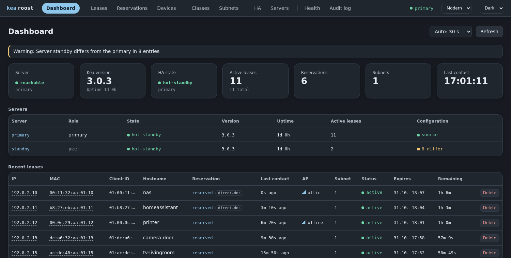
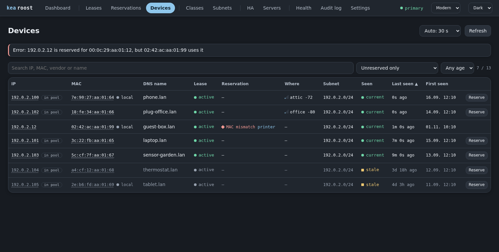
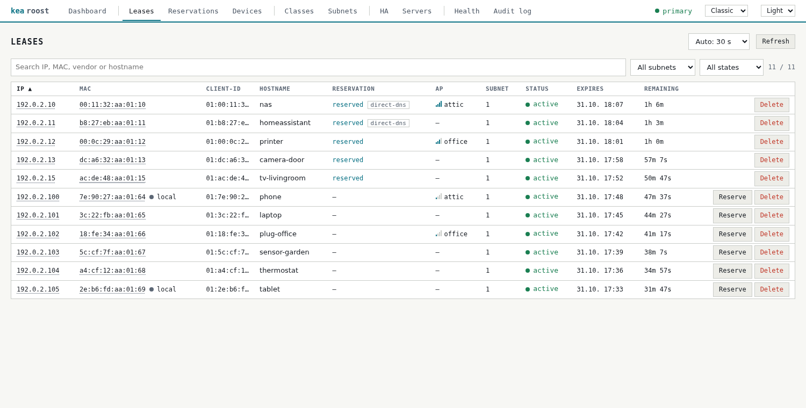
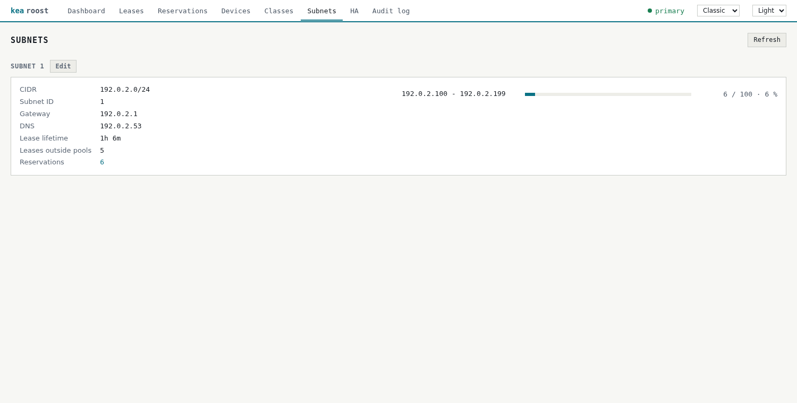
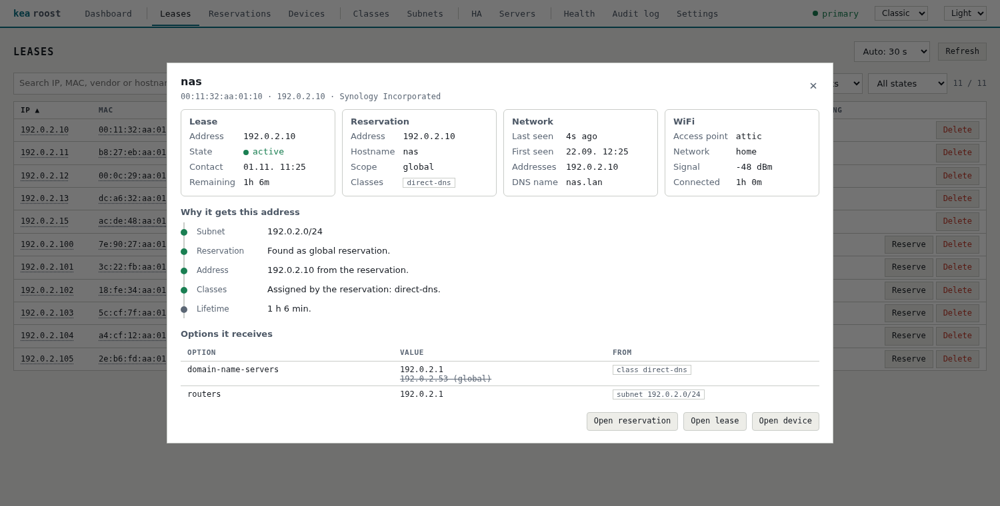
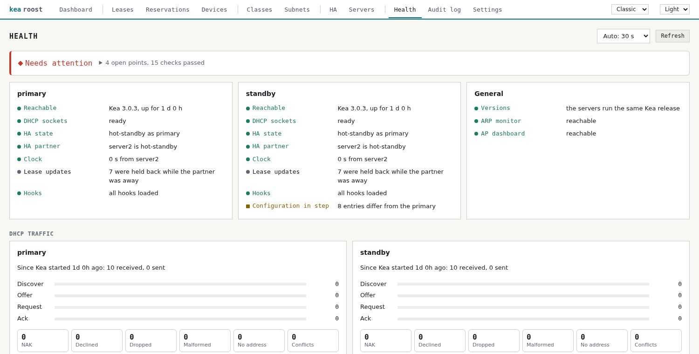
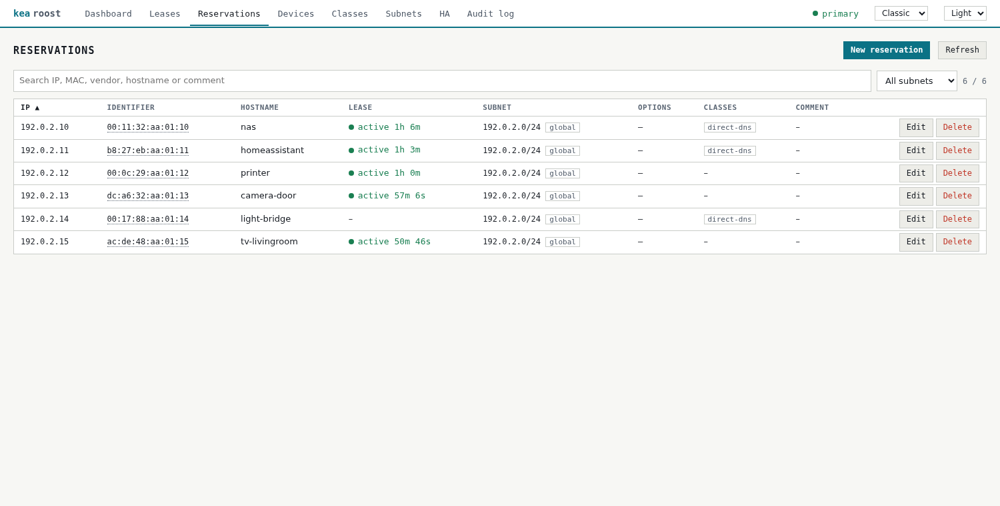
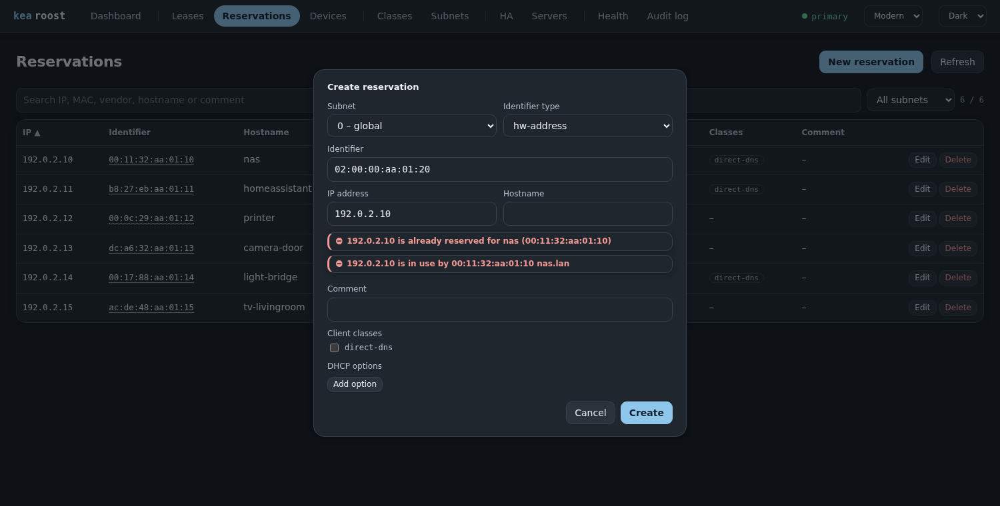

# Kea Roost: Web UI for the ISC Kea DHCP Server

[](https://github.com/vgropp/kea-roost/actions/workflows/test.yml)
[](LICENSE)

Kea Roost is a lightweight, self-hosted web interface and dashboard for the
[ISC Kea](https://www.isc.org/kea/) DHCPv4 server. Manage DHCP leases and reservations,
client classes, subnets and pools in the browser, keep an HA pair in step and operate
it, find out why a client gets its address, and see which devices on the network have
no reservation yet.

It is a single Go binary with the frontend embedded, runs in Docker, and needs no
database or agents. It talks to Kea exclusively through the Kea management API and
takes no part in DHCP operation: if it stops, Kea keeps serving.

Tested with Kea 3.0.3 and 3.0.4, on its own or as a hot-standby HA pair.
Kea Roost is an independent project, not affiliated with or endorsed by ISC, and is
licensed under the [MIT License](LICENSE).

## Why Kea Roost

Kea has no web interface of its own and is configured through JSON files and an API.
[ISC Stork](https://www.isc.org/stork/) is the official dashboard for larger
deployments, with agents and a PostgreSQL database. Kea Roost is meant for a home lab
or a small network: one container, no database, and everyday tasks such as turning a
lease into a static DHCP reservation in two clicks.

## Features

- **Dashboard:** state of every server, HA state, lease, reservation and subnet
  counts, pool utilization, warnings, and the most recent leases.
- **Leases:** search, filters, sorting, automatic refresh, MAC vendors, deleting a
  lease, and creating a reservation from a lease.
- **Reservations:** create, edit and delete global and subnet reservations, change
  the MAC, assign client classes and DHCP options, comments, and links to the lease.
- **Client classes:** create, edit and delete classes and their DHCP options.
- **Subnets:** gateway, DNS servers, lease lifetime and pools with their utilization,
  and editing all of them.
- **Several Kea servers:** every change reaches all servers, primary first. A
  comparison shows what differs, and one click copies it from the primary. If the
  primary fails, the interface keeps working read-only from a peer, see
  [Several Kea servers](#several-kea-servers).
- **HA:** state of this server and its partner, and operating the pair: start and end
  maintenance, sync leases, reset and continue.
- **Devices:** everything on the network with and without a reservation, how recently
  it was seen, and addresses used by the wrong device.
- **[arpmonitor](https://github.com/vgropp/arpmonitor) integration (optional):**
  finds wired, static and otherwise silent devices through ARP, including DNS names and
  when a device was first and last seen. An active ARP scan shows what is online now.
- **[openwrt-ap-dashboard](https://github.com/vgropp/openwrt-ap-dashboard) integration
  (optional):** shows the access point, network and signal of WiFi clients on the
  devices and leases pages.
- **Client details:** a click on an address or MAC in any table opens everything about
  that client: lease, reservation, network, WiFi and its changes. It explains why the
  client gets its address and which level sets each DHCP option, including what that
  overrides, and says what cannot be known without the client's packet, see
  [Diagnostics](#diagnostics).
- **Health:** one page for every server: reachability, sockets, HA, clock, hooks,
  integrations, and DHCP traffic from Discover to Ack with drops, NAKs and failed
  allocations.
- **Settings:** limits and time windows editable in the interface, see
  [Settings](#settings).
- **Configuration review:** finds what Kea accepts without complaint, such as ignored
  reservations, unused classes, duplicate addresses and overlapping pools.
- **DNS names:** keeps a hosts file of all reservations for dnsmasq or another DNS
  server, see [DNS names](#dns-names-for-reservations).
- **Prometheus metrics:** compatible with the common Kea exporters, plus findings, HA and
  devices, see [Prometheus metrics](#prometheus-metrics).
- **Audit log:** every change with its user and result, with the name and address of a
  reservation, filters and pages, and downloadable backups.
- **Safety checks:** see [How changes are applied](#how-changes-are-applied).
- **Interface:** Classic and Modern themes in light and dark, usable on a phone,
  without external resources or telemetry.

Editing subnets and client classes needs the matching Kea hooks, see
[Kea configuration](#kea-configuration). The devices page needs at least one of the two
integrations, see [Devices](#devices).

## Screenshots

The pictures show invented devices.

| Dashboard (Modern, dark) | Devices (Modern, dark) |
|---|---|
|  |  |

| Leases (Classic, light) | Subnets (Classic, light) |
|---|---|
|  |  |

| Client details (Classic, light) | Health (Classic, light) |
|---|---|
|  |  |

| Reservations (Classic, light) | New reservation with an address conflict |
|---|---|
|  |  |

## Install with Docker Compose

Images for `linux/amd64` and `linux/arm64` are published to the GitHub Container Registry
as `ghcr.io/vgropp/kea-roost`:

    curl -LO https://raw.githubusercontent.com/vgropp/kea-roost/main/compose.yaml
    curl -L -o .env https://raw.githubusercontent.com/vgropp/kea-roost/main/.env.example

In `compose.yaml`, uncomment the `image` line and delete the `build` and `image` lines
below it. Set `KEA_URL` and the passwords in `.env`, then start it:

    docker compose up -d

`latest` follows the newest release. To stay on one, set `KEA_ROOST_VERSION=0.8` for a
release line or `KEA_ROOST_VERSION=0.8.0` for exactly one version in `.env`.
`KEA_ROOST_VERSION=snapshot` follows every tested commit on `main`, for trying out what
comes next.

To build from source instead, keep `compose.yaml` as it is:

    git clone https://github.com/vgropp/kea-roost
    cd kea-roost
    go run ./cmd/oui-update  # fetches the vendor table, needed once
    cp .env.example .env     # then set KEA_URL and the passwords
    docker compose up -d --build

The interface is served on port 8080 (`MANAGER_PORT`). Backups and the audit log
live in the `data` volume. The container runs as an unprivileged user with a
read-only root filesystem.

The container must be able to reach the Kea control socket. If Kea runs on the
Docker host, use `host.docker.internal` in `KEA_URL`. `127.0.0.1` would mean the
container itself. Kea must then listen on an address the container can reach,
not on `127.0.0.1`. The service runs on Docker's default bridge network because
hosts can block project networks from reaching local services.

## Build and test without Docker

The vendor table is not part of the repository. Fetch it once before the first
build, also before building the Docker image:

    go run ./cmd/oui-update

Then:

    go build -o kea-roost ./cmd/kea-roost
    go test ./...

To work on the interface without a real server, run it against the test double:

    go run ./cmd/fake-kea -listen 127.0.0.1:8000 &
    KEA_URL=http://127.0.0.1:8000 MANAGER_USER=admin MANAGER_PASSWORD=admin \
      MANAGER_DATA_DIR=./data go run ./cmd/kea-roost

To also run the browser tests, which need a local Chromium or Chrome:

    go test -tags e2e ./internal/web

The integration tests run the manager against the real `kea-dhcp4` binary. Each
test starts a private server with a synthetic configuration, without any DHCP
interface, and restarts it to check what was stored. They are skipped if Kea is not
installed:

    go test -tags kea ./internal/manager

The screenshots above are written by a test from invented data:

    SCREENSHOT_DIR=docs/screenshots go test -tags e2e -run TestScreenshots ./internal/web

## Configuration

All settings come from environment variables.

| Variable | Meaning | Default |
|---|---|---|
| `KEA_URL` | URL of the Kea HTTP control socket | required |
| `KEA_USER`, `KEA_PASSWORD` | Basic auth of the socket | empty |
| `KEA_CA_FILE` | CA for HTTPS | system CAs |
| `KEA_CLIENT_CERT`, `KEA_CLIENT_KEY` | Client certificate (for `cert-required`) | empty |
| `KEA_SERVER_NAME` | Display name of the server | `kea` |
| `KEA_PEERS` | Further Kea servers as `name=url,name=url`, same credentials as `KEA_URL` | empty |
| `METRICS_ENABLED` | Set to `false` to remove `/metrics` | `true` |
| `METRICS_USER`, `METRICS_PASSWORD` | Login for `/metrics`, see [Prometheus metrics](#prometheus-metrics) | open |
| `DNS_HOSTS_DIR` | Folder for a hosts file of all reservations, see [DNS names](#dns-names-for-reservations) | off |
| `DNS_HOSTS_DOMAIN` | Domains added to reservation names without one, comma separated | empty |
| `MANAGER_LISTEN` | Listen address | `:8080` |
| `MANAGER_USER`, `MANAGER_PASSWORD` | Login of the interface | empty |
| `APDASHBOARD_URL` | Base URL of an [openwrt-ap-dashboard](https://github.com/vgropp/openwrt-ap-dashboard), adds WiFi clients to leases and devices | empty |
| `MANAGER_BASE_PATH` | Subpath behind a reverse proxy that does not strip it, e.g. `/kea-roost` | empty |
| `MANAGER_DATA_DIR` | Backups and audit log | `/var/lib/kea-roost`, `/data` in the image |
| `ARPMONITOR_URL` | Base URL of an [arpmonitor](https://github.com/vgropp/arpmonitor) with port and without path, enables the devices page | empty |

`KEA_PASSWORD`, `MANAGER_PASSWORD` and `METRICS_PASSWORD` can instead be read from a file
through `KEA_PASSWORD_FILE`, `MANAGER_PASSWORD_FILE` and `METRICS_PASSWORD_FILE`, for
example a Docker secret.

Without a login the manager runs read-only: changes, backups and the audit log
are locked. The interface itself only speaks HTTP, so TLS belongs in a reverse
proxy in front of it. Do not expose the manager unprotected: backups contain the
Kea configuration including plaintext passwords.

## Kea configuration

The manager does not change the Kea installation. Tested with Kea 3.0.3 and 3.0.4.
`kea-dhcp4` is expected to have:

- a `control-sockets` entry of type `http` or `https`,
- the hooks `libdhcp_lease_cmds.so` and `libdhcp_host_cmds.so`,
- `libdhcp_ha.so` for the HA page,
- `libdhcp_subnet_cmds.so` to edit subnets on the subnets page,
- `libdhcp_class_cmds.so` to edit client classes on the classes page.

Writes are refused while `config-get` reports a binary option without a value.
Kea does that for `vendor-encapsulated-options` given as hex, and `config-write`
would then store the empty value.

If a hook is missing, the dashboard shows a warning and everything else keeps working.

A configuration with all of them, inside the `Dhcp4` block of `kea-dhcp4.conf`:

```json
"control-sockets": [
  {
    "socket-type": "http",
    "socket-address": "192.0.2.1",
    "socket-port": 8051,
    "authentication": {
      "type": "basic",
      "clients": [ { "user": "manager", "password": "change-me" } ]
    }
  }
],
"hooks-libraries": [
  { "library": "libdhcp_lease_cmds.so" },
  { "library": "libdhcp_host_cmds.so" },
  { "library": "libdhcp_subnet_cmds.so" },
  { "library": "libdhcp_class_cmds.so" }
]
```

Add the entries to existing lists instead of creating second ones, and keep the
parameters a hook such as `libdhcp_ha.so` already has. Limit the port to the host of
the manager, because the socket can change the whole configuration. Then set in
`.env`:

    KEA_URL=http://192.0.2.1:8051
    KEA_USER=manager
    KEA_PASSWORD=change-me

Changes rewrite `kea-dhcp4.conf` through `config-write`, so Kea needs write access to
that file. It then contains all default values, and comments in it are lost.

## Several Kea servers

Kea HA copies leases, not configuration. With `KEA_PEERS` set, Kea Roost keeps the
reservations, client classes and subnets of all servers the same:

    KEA_URL=http://192.0.2.1:8051
    KEA_SERVER_NAME=primary
    KEA_PEERS=standby=http://192.0.2.2:8051

- All pages read from the primary. While it is down, they show the data of the first
  peer that answers and the dashboard says so. Changes are refused until the primary
  is back, because they always start there.
- A change runs on the primary first, then on each peer: backup, change,
  `config-write`, verification. Each server writes its own file, so
  `this-server-name` and `interfaces-config` stay as they are.
- If a server fails, the change stops there and reports `partial`. Nothing is
  rolled back. The primary failing leaves the peers untouched.
- The Servers page lists what differs from the primary. **Copy from primary** makes
  a peer match it, which also deletes what only the peer holds. Subnets that are
  missing, extra or hold their own reservations stay manual.
- Deleting a lease also deletes it on the peers.
- The HA page operates the pair: start and end maintenance, sync leases, reset and
  continue. It offers what the state of the server allows, and every action is
  written to the audit log. Maintenance needs both servers in `KEA_PEERS`.

Every peer needs the hooks of the primary, a control socket with the same login,
and a configuration file the Kea user can write. Settings outside of these three
areas, such as global options, are neither compared nor copied.

## Prometheus metrics

`/metrics` serves all metrics in the Prometheus format. It needs no login by default, like
most exporters, and shows server names, subnets, and counts of devices and findings. To
protect it, set `METRICS_USER` and `METRICS_PASSWORD`: this login opens only this path, and
the login of the interface does not work there. `METRICS_ENABLED=false` removes the path altogether.

    scrape_configs:
      - job_name: kea-roost
        metrics_path: /metrics
        # only with METRICS_USER
        basic_auth:
          username: prometheus
          password_file: /etc/prometheus/kea-roost-password
        static_configs:
          - targets: ["kea-roost:8080"]

The Kea metrics keep the names of the common Kea exporters, so existing dashboards keep
working: `kea_dhcp4_packets_received_total`, `kea_dhcp4_addresses_assigned_total`,
`kea_dhcp4_global4_*`, `kea_dhcp4_pool_*` and so on. Each carries a `server` label, for
HA pairs. The subnet metrics carry the labels of both exporters, `subnet`, `subnet_id`,
`prefix`, `shared_network` and an empty `pool`. Pools are reported in their own
`kea_dhcp4_pool_*` metrics only, so a sum over subnets counts nothing twice.

Kea Roost adds what only it knows:

| Metric | Meaning |
|---|---|
| `roost_server_up`, `roost_server_uptime_seconds` | Each Kea server |
| `roost_ha_state`, `roost_ha_partner_in_touch`, `roost_ha_clock_skew_seconds` | The HA pair |
| `roost_config_differences` | Entries a peer holds differently from the primary |
| `roost_findings`, `roost_rule_findings`, `roost_findings_hidden`, `roost_rules_skipped` | The configuration review |
| `roost_health_checks` | Health checks per result |
| `roost_reservations`, `roost_leases_active` | Counts |
| `roost_devices_online`, `roost_devices_known`, `roost_arp_monitor_up` | From the ARP monitor |
| `roost_wifi_clients`, `roost_ap_dashboard_up` | From the AP dashboard |
| `roost_dns_hosts_file_ok`, `roost_info` | The hosts file and the version |

A scrape runs the same queries as the Health page, so an interval of a minute is enough.

## Settings

The Settings page holds limits and time windows: how far back the devices page and the
review look, when a device counts as online, and the thresholds of warnings. They are
saved in `settings.json` in the data volume and apply at once. Values that are not
changed there keep their default.

Addresses, logins and other settings of the deployment stay in the environment and
never end up in this file.

## DNS names for reservations

Kea Roost can keep a hosts file of all reservations, so that a DNS server resolves the
names you give in the interface. It needs no change to Kea and no script. With dnsmasq:

    mkdir -p /var/lib/kea-roost-dns
    chown 65532 /var/lib/kea-roost-dns

Add this to `.env` and run `docker compose up -d`:

    DNS_HOSTS_DIR=/var/lib/kea-roost-dns
    DNS_HOSTS_DOMAIN=lan

And this to the dnsmasq configuration, which then follows the file by itself:

    hostsdir=/var/lib/kea-roost-dns

The file has a line for every reservation with an address and a name:

    192.0.2.10 nas.lan nas

With `DNS_HOSTS_DOMAIN=lan,home` a name resolves as `nas`, `nas.lan` and `nas.home`.
Reverse lookups answer with the first domain. A name that already has a domain stays as
it is. Characters DNS does not allow become a dash, so `living room tv` resolves as
`living-room-tv`.

A device with a static address gets its name the same way: create a reservation for it.
It does no harm, because the device never asks. Leases are left out on purpose, because
a client picks that name itself and could claim the name of another device.

The file is rewritten right after a change and checked every minute, which catches
changes made in Kea directly. If Kea cannot be reached, the old file stays, and the
Health page says so. Other hosts files work as well: the `hosts` plugin of CoreDNS can
read it, for example.

## Diagnostics

Everything here only reads. It needs no extra setup, no access to the Kea logs and no
packet capture: it works from the Kea API and, if configured, the two integrations.

### Client details

Click an address or MAC in the leases, reservations or devices table, or in the recent
leases on the dashboard. The tables stay where they are, and a popup shows:

- the lease, the reservation, what the network saw and the WiFi connection,
- a step by step answer to why the client has its address: which subnet, whether a
  reservation applies, where the address comes from, its classes and its lease lifetime,
- every DHCP option it receives, which level sets it, and the values that one
  overrides. From weak to strong: global, client class, shared network, subnet, pool,
  reservation,
- the changes made to this client, from the audit log.

It also names what goes wrong: a reservation Kea ignores because
`reservations-global` or `reservations-in-subnet` is off, a reserved address held by
another client, a client that moves at its next renewal, or a device using an address
inside a pool without a lease.

The explanation is retraced from the configuration, not read from Kea. What depends on
the packet of the client is listed instead of guessed: a class with a `test` only shows
up as "applies if the client matches". A device without a lease outside of the pools
counts as *probably* static, because a foreign DHCP server would look the same.

### Health

The Health page runs its checks each time it loads, per server. The number on top opens
the list of all checks, with open points first:

| Area | What is checked |
|---|---|
| Server | Reachable, Kea version, uptime, DHCP sockets |
| HA | State, partner, clock skew, lease updates held back while the partner was away |
| Hooks | Which are loaded and what is missing without them |
| Configuration | Write lock from a lost option, same state on all servers, same Kea release |
| Integrations | arpmonitor and openwrt-ap-dashboard reachable |

The DHCP traffic shows Discover, Offer, Request and Ack as bars, with counters for NAKs,
declined addresses, drops, malformed packets, failed allocations and reservation
conflicts. All of them count since Kea started. Shares are only rated from 50 packets
on, and drops on a standby do not count, because it leaves requests to the primary.

### Configuration review

Kea starts happily with many mistakes. The review lists them, worst first:

- **Problems:** reservations ignored by a setting, addresses reserved twice, reservations
  outside of their subnet, overlapping pools, pools reaching outside of the subnet.
- **Warnings:** a class that does not exist, a hostname used twice, an address in no
  subnet, a gateway outside of the subnet, a subnet that serves nobody.
- **Notes:** classes that never apply, reserved addresses inside a pool, options set to
  the value they inherit anyway, subnets without a gateway or DNS server.

With the [ARP monitor](#arpmonitor), the review also compares Kea with what is really on
the network:

- **Problems:** two devices online with one address, a device online with an address
  reserved for another one.
- **Warnings:** a device online with another address than its reservation or lease, an
  address leased to another device, an online address inside a pool without a lease.
- **Notes:** an active lease whose device has not been seen for an hour, a reservation
  whose device was not seen for a year. The time spans are set on the Settings page.

"Online" means seen within the last 15 minutes by default. Devices that sleep or stay silent can
show up as notes. Clients the AP dashboard reports count as seen. Addresses are only
compared for reservations by MAC address. If a source is unreachable or empty, including
the AP dashboard, all of these rules say so instead of reporting nothing. Each finding
links to its entry.

A finding that is intended, such as a device with a second address on purpose, can be
hidden with its button. It stops counting and stays available in the filter of the table,
where it can be shown again. This holds for that rule and that entry only.

The number above the findings opens the list of all rules with their results. Warnings
in the log of Kea are not part of this, because its API does not offer them.

A note is not a mistake. A reservation inside a pool works, for example; it can only
collide with a client that got the address before.

## Devices

The devices page shows what is on the network and has no reservation for its MAC or
address; a filter also shows the reserved ones. **Reserve** opens the reservation
dialog with address, MAC and name filled in. Devices are marked current (seen within
the last 15 minutes), recent (last day) or stale, newest first, and an address used by
another device than the reserved one is marked as a MAC mismatch.

The page gets its data from two optional integrations. It needs at least one of them,
and it does not exist without any. Only devices inside a configured subnet are listed.
If a source is unreachable, only its information is missing.

### arpmonitor

[arpmonitor](https://github.com/vgropp/arpmonitor) records MAC and IP addresses from
ARP traffic, so it also finds wired and static devices that Kea knows nothing about.
It resolves names through DNS and knows when a device was first and last seen. Run it
with `--arp-scan-interval=5m` to also find silent devices and to make the last seen
time reflect what is online right now.

`ARPMONITOR_URL` is the base URL, for example `http://host.docker.internal:8253`; Kea
Roost appends the API path itself. The [Settings](#settings) page sets how far back each
query looks. How long data is kept is decided by the `--retention-days` flag of the
monitor, so a larger window than that shows little more.

### openwrt-ap-dashboard

[openwrt-ap-dashboard](https://github.com/vgropp/openwrt-ap-dashboard) collects the
WiFi clients of several OpenWrt access points. With `APDASHBOARD_URL` set, the devices
and leases pages show the access point and signal of WiFi clients, with the network in
the tooltip. A connected client counts as seen now, and clients the monitor does not
know get their own entry. Kea Roost only reads from the dashboard.

## MAC vendors

MAC addresses show their vendor as a tooltip, and the search covers it too.
Locally assigned addresses, as used by phones, bridges and VMs, are marked
`local`. The
vendor table is embedded in the binary, so no internet access is needed at
runtime. `go run ./cmd/oui-update` refreshes it from the IEEE data published by
Wireshark.

## Behind a reverse proxy

The manager can be served from a subpath such as `/kea-roost/`, because the
interface only uses relative URLs. The URL needs the trailing slash, or the proxy
has to redirect to it.

- If the proxy strips the subpath, nothing has to be set.
- If it forwards the path unchanged, set `MANAGER_BASE_PATH` to the same subpath.

For writes to pass the cross-origin check, the proxy has to keep the original
`Host` header or send `X-Forwarded-Host`. The login of the manager uses Basic Auth
as well, so the proxy must not demand a login of its own for this path.

## Themes

The header offers two themes, the dense and square Classic and the round and airy
Modern. Each comes in light and dark, and Auto follows the system setting. The
browser remembers the choice.

