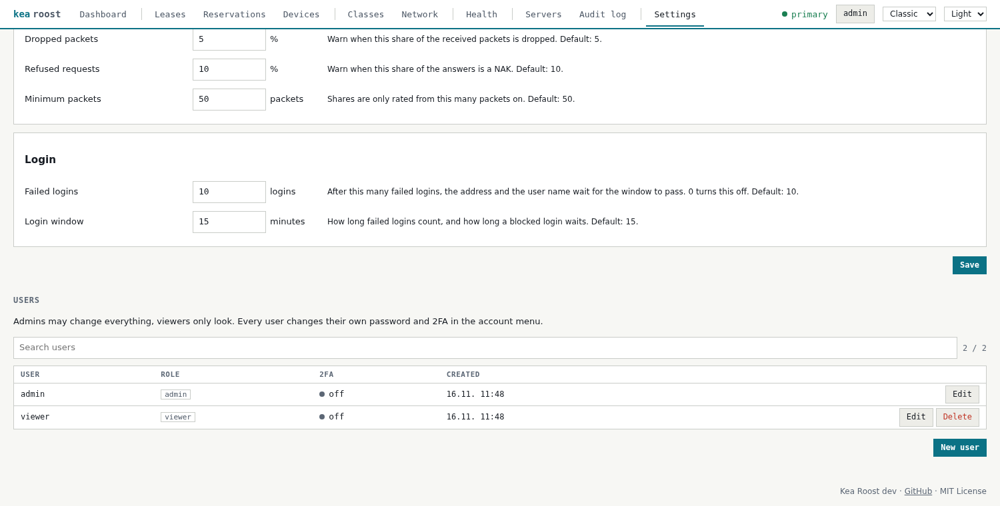
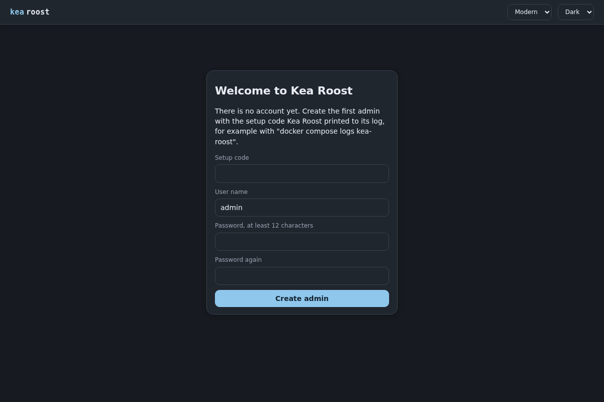
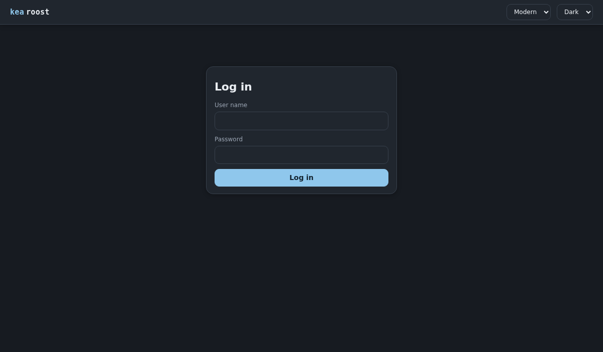

# Accounts

[Back to the overview](../README.md)

The interface needs an account. Accounts live in `users.json` in the data volume, with
their passwords hashed by Argon2id.



## The first admin

As long as no account exists, the interface asks for the first admin. So that nobody
else on the network can claim a fresh instance, this needs a setup code from the log:

    docker compose logs kea-roost | grep "setup code"

The code changes with every start and is useless once the first account exists.



## Roles

| Role | May |
|---|---|
| `admin` | Everything: change Kea, backups, audit log, settings, users |
| `viewer` | Look at every page, change nothing; the changes in the client popup come from the audit log and stay hidden |

Admins manage accounts under Users on the Settings page. The last admin cannot be
removed or demoted, and nobody can remove their own account. Everybody, admins
included, changes their own password and 2FA in the account menu, which asks for the
current password.

## Sessions



- A login starts a session cookie that scripts cannot read and other sites do not get.
- It ends after 12 hours without a request, and after 7 days in any case.
- A new password ends the other sessions of the account; a changed role applies at once.
- An account keeps at most 20 sessions; another login ends the oldest.
- Sessions live in memory: a restart of Kea Roost logs everybody out.

Logins and account changes go to the audit log, failed logins to the log of Kea Roost.

## Two-factor authentication

Every user can turn on 2FA with TOTP (RFC 6238) by the switch in the account menu. Kea
Roost shows a secret as QR code and text for any TOTP app. Turning it on or off asks
for a TOTP code and the current password; a setup not confirmed within 10 minutes is
dropped. A login then asks for a code after the password, and each code works once.

The TOTP secret is stored in `users.json` as it is, because the server needs it: treat
the data volume like the passwords of all accounts. The last used code is kept in
memory only, so after a restart it works once more within its 30 seconds. If a device
is lost, an admin resets 2FA of that account under Users.

## Single sign-on

Kea Roost can leave the login to an OpenID Connect provider such as Authelia. The
login form then shows a button for it, next to the password, or instead of it with
`PASSWORD_LOGIN=false`. A second factor is then the provider's business: a login
through it does not ask for the TOTP code of Kea Roost.

Register Kea Roost as a client at the provider. For Authelia, in its
`configuration.yml`:

```yaml
identity_providers:
  oidc:
    clients:
      - client_id: kea-roost
        client_name: Kea Roost
        client_secret: '$pbkdf2-sha512$...'   # authelia crypto hash generate
        redirect_uris: [ 'https://roost.example.com/api/login/oidc/callback' ]
        scopes: [ openid, profile, groups ]
        authorization_policy: two_factor
        require_pkce: true
        pkce_challenge_method: S256
        token_endpoint_auth_method: client_secret_basic
```

and in `.env` of Kea Roost:

    OIDC_ISSUER=https://auth.example.com
    OIDC_CLIENT_ID=kea-roost
    OIDC_CLIENT_SECRET=the secret before hashing
    OIDC_REDIRECT_URL=https://roost.example.com/api/login/oidc/callback
    OIDC_LABEL=Authelia

Kea Roost asks for the scopes `openid`, `profile` and `groups`, checks the signature
and nonce of the ID token and uses PKCE. It reads the user name
(`preferred_username`) and the groups from the UserInfo endpoint, where Authelia puts
them, and checks that UserInfo describes the same person as the ID token.

**Existing accounts.** Log in with the password as before, open the account menu and
choose *Link with ...*. After the login at the provider, the account is linked and
single sign-on logs into it; the audit log records the link. Linking needs the
password and 2FA of the account, so a login at the provider alone never takes an
account over. The link names the login at the provider for good, not its name: a
renamed user keeps the account. An admin can remove a link under Users. The password
stays, as a way in while the provider is down.

`OIDC_LINK_BY_NAME=true` links the first login to the account of the same name
instead, without asking. Turn it on only if nobody can choose or change their name at
the provider: whoever logs in there as `admin` gets the account `admin`, and its 2FA
does not ask.

**Roles.** Without `OIDC_ADMIN_GROUP` and `OIDC_VIEWER_GROUP`, only existing accounts
log in, with the role they have. With them, the groups decide the role at each login,
a login in neither group is refused, and a new user gets an account without a
password. A login that would take the admin role from the last admin is refused:
give the account the admin group at the provider, or make another admin first.

Logging out ends the session of Kea Roost, not the one at the provider. Logins on
their way to the provider are counted per address, so behind a proxy name it in
`MANAGER_TRUSTED_PROXIES`, as for failed logins.

## Failed logins

After 10 failed logins within 15 minutes, further logins of that address and of that
user name wait until the window has passed. Wrong TOTP codes, setup codes and current
passwords count the same way. Both values are on the [Settings](configuration.md#settings)
page; 0 turns the limit off.

Anybody who can reach the login form can keep an account waiting by guessing wrong on
purpose. Where that matters, turn the limit off and let a proxy limit logins instead.
Behind a proxy, name it in `MANAGER_TRUSTED_PROXIES`, see
[Behind a reverse proxy](configuration.md#behind-a-reverse-proxy).

## Lost passwords

There is no reset by mail. An admin sets a new password under Users. If nobody can log
in any more, delete `users.json` and create a new first admin:

    docker compose down
    docker run --rm -v kea-roost_data:/data alpine rm /data/users.json
    docker compose up -d

