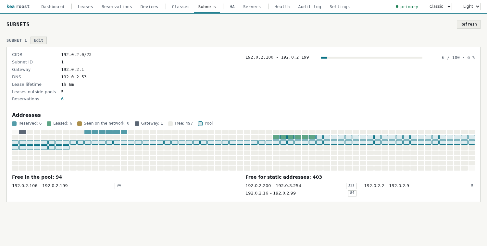
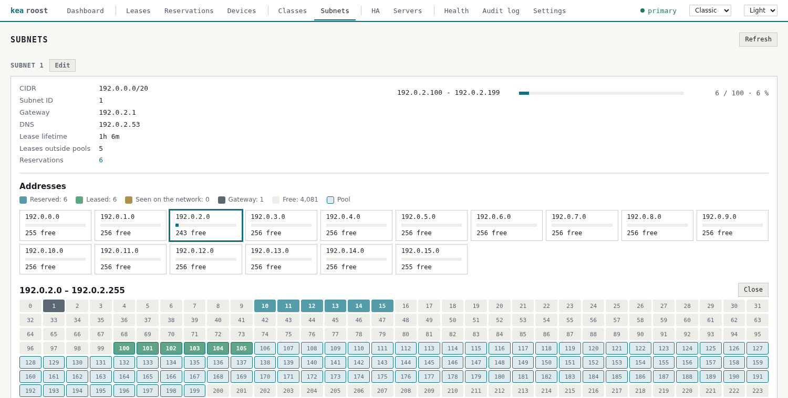

# Address map

[Back to the overview](../README.md)

The Subnets page shows every address of a subnet up to a /22 as a colored square, smaller
from a /23 on. A click on a used one opens the client. Larger subnets show a tile per /24
with its load, and a click on one opens its squares. Below it are the largest free ranges,
split into those inside a pool and those free for static addresses, with the complete list
to unfold.

An address counts as free when it is neither reserved nor leased and no device uses it.
Outside of the pools that means within the window of the devices page, set on the Settings
page. Inside a pool only the current address of a device online right now counts, because
addresses change hands there all the time. Without the ARP monitor,
static devices are unknown, and the page says so. A device that stays off for longer also
looks free, so check before you hand out an address that matters. Subnets larger than a
/16 show neither.

## Larger subnets

A /23 or /22 keeps one square per address, without numbers.

From a /21 on, a tile stands for a /24. A click on one opens its squares.

