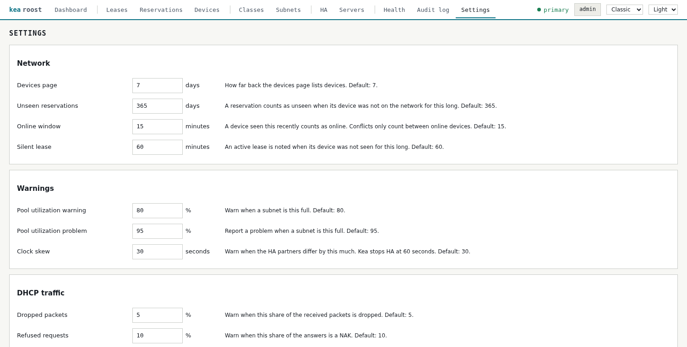

# Configuration

[Back to the overview](../README.md)

## Environment

Kea Roost reads its settings from environment variables, usually `.env`.

| Variable | Meaning | Default |
|---|---|---|
| `KEA_URL` | Control socket of `kea-dhcp4`, see [Kea configuration](kea-configuration.md) | required |
| `KEA_USER`, `KEA_PASSWORD` | Basic auth of the socket | empty |
| `KEA_CA_FILE` | CA for HTTPS | system CAs |
| `KEA_CLIENT_CERT`, `KEA_CLIENT_KEY` | Client certificate (for `cert-required`) | empty |
| `KEA_SERVER_NAME` | Display name of the server | `kea` |
| `KEA_PEERS` | Further servers as `name=url,name=url`, see [Several Kea servers](several-servers.md) | empty |
| `KEA6_URL` | Control socket of `kea-dhcp6`, see [IPv6](ipv6.md) | empty |
| `KEA6_PEERS` | Further `kea-dhcp6` servers, like `KEA_PEERS` | empty |
| `DNS_HOSTS_DIR`, `DNS_HOSTS_DOMAIN` | Hosts file of all reservations, see [DNS names](dns-names.md) | off |
| `ARPMONITOR_URL` | [arpmonitor](devices.md#arpmonitor), base URL with port | empty |
| `APDASHBOARD_URL` | [openwrt-ap-dashboard](devices.md#openwrt-ap-dashboard), base URL | empty |
| `METRICS_ENABLED` | `false` removes `/metrics` | `true` |
| `METRICS_USER`, `METRICS_PASSWORD` | Login for `/metrics`, see [Prometheus metrics](metrics.md) | open |
| `MANAGER_LISTEN` | Listen address | `:8080` |
| `MANAGER_BASE_PATH` | Subpath behind a proxy that keeps it, e.g. `/kea-roost` | empty |
| `MANAGER_TRUSTED_PROXIES` | Proxies whose `X-Forwarded-For` is trusted, comma separated | empty |
| `MANAGER_DATA_DIR` | Accounts, settings, backups and audit log | `/var/lib/kea-roost`, `/data` in the image |

Two more are read by `compose.yaml` only: `MANAGER_PORT`, the port on the Docker host
(default `8080`), and `KEA_ROOST_VERSION`, the image tag (default `latest`, see the
[README](../README.md#install-with-docker-compose)). `ARPMONITOR_DAYS` and the
`MANAGER_USER` settings of earlier versions are no longer read; the start names them
when they are still set. The windows of the ARP monitor are on the Settings page now.

All `kea-dhcp6` and peer sockets use the login of `KEA_URL`. `KEA_PASSWORD` and
`METRICS_PASSWORD` can also come from a file through `KEA_PASSWORD_FILE` and
`METRICS_PASSWORD_FILE`, such as a Docker secret.

Backups contain the Kea configuration with its passwords in plain text, so do not expose
Kea Roost unprotected. It speaks HTTP only; TLS belongs in a proxy in front.

## Settings

The Settings page holds time windows and thresholds: how far back the devices page and
the review look, when a device counts as online, when warnings start, and the limit of
failed logins. They are saved in `settings.json` in the data volume and apply at once.
Below them, admins manage the [accounts](accounts.md).

## Behind a reverse proxy

The interface only uses relative URLs, so it can live under a subpath such as
`/kea-roost/`, with the trailing slash.

- A proxy that strips the subpath needs nothing more; one that keeps it needs
  `MANAGER_BASE_PATH`.
- Writes pass the cross-origin check only if the proxy keeps the `Host` header or sends
  `X-Forwarded-Host`.
- With HTTPS at the proxy, send `X-Forwarded-Proto: https`, so the session cookie is
  limited to HTTPS.
- Failed logins are counted per address, and behind a proxy every request comes from
  it. Name the proxy in `MANAGER_TRUSTED_PROXIES`, so the client address is taken from
  `X-Forwarded-For`. Its address is in the log after a failed login; on the Docker host
  it is usually the gateway of the Docker bridge. Name only proxies: any host in the
  list can claim any client address.

## MAC vendors

MACs show their vendor in a tooltip, and the search covers it. Locally assigned MACs,
as used by phones, bridges and VMs, are marked `local`. The vendor table is built into
the binary; `go run ./cmd/oui-update` refreshes it from the IEEE data published by
Wireshark.

## Themes

Classic is dense and square, Modern round and airy. Each comes in light and dark, and
Auto follows the system. The browser remembers the choice.
