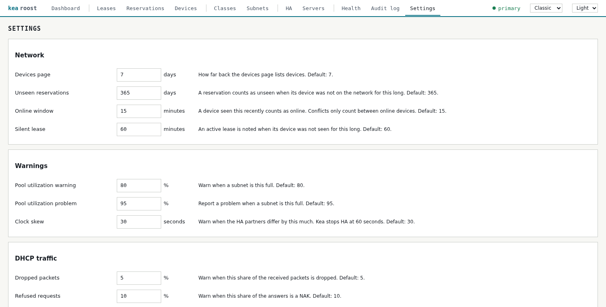

# Configuration

[Back to the overview](../README.md)

## Configuration

All settings come from environment variables.

| Variable | Meaning | Default |
|---|---|---|
| `KEA_URL` | URL of the Kea HTTP control socket | required |
| `KEA_USER`, `KEA_PASSWORD` | Basic auth of the socket | empty |
| `KEA_CA_FILE` | CA for HTTPS | system CAs |
| `KEA_CLIENT_CERT`, `KEA_CLIENT_KEY` | Client certificate (for `cert-required`) | empty |
| `KEA_SERVER_NAME` | Display name of the server | `kea` |
| `KEA_PEERS` | Further Kea servers as `name=url,name=url`, same credentials as `KEA_URL` | empty |
| `METRICS_ENABLED` | Set to `false` to remove `/metrics` | `true` |
| `METRICS_USER`, `METRICS_PASSWORD` | Login for `/metrics`, see [Prometheus metrics](metrics.md) | open |
| `DNS_HOSTS_DIR` | Folder for a hosts file of all reservations, see [DNS names](dns-names.md) | off |
| `DNS_HOSTS_DOMAIN` | Domains added to reservation names without one, comma separated | empty |
| `MANAGER_LISTEN` | Listen address | `:8080` |
| `MANAGER_USER`, `MANAGER_PASSWORD` | Login of the interface | empty |
| `APDASHBOARD_URL` | Base URL of an [openwrt-ap-dashboard](https://github.com/vgropp/openwrt-ap-dashboard), adds WiFi clients to leases and devices | empty |
| `MANAGER_BASE_PATH` | Subpath behind a reverse proxy that does not strip it, e.g. `/kea-roost` | empty |
| `MANAGER_DATA_DIR` | Backups and audit log | `/var/lib/kea-roost`, `/data` in the image |
| `ARPMONITOR_URL` | Base URL of an [arpmonitor](https://github.com/vgropp/arpmonitor) with port and without path, enables the devices page | empty |

`KEA_PASSWORD`, `MANAGER_PASSWORD` and `METRICS_PASSWORD` can instead be read from a file
through `KEA_PASSWORD_FILE`, `MANAGER_PASSWORD_FILE` and `METRICS_PASSWORD_FILE`, for
example a Docker secret.

Without a login the manager runs read-only: changes, backups and the audit log
are locked. The interface itself only speaks HTTP, so TLS belongs in a reverse
proxy in front of it. Do not expose the manager unprotected: backups contain the
Kea configuration including plaintext passwords.

## Settings

The Settings page holds limits and time windows: how far back the devices page and the
review look, when a device counts as online, and the thresholds of warnings. They are
saved in `settings.json` in the data volume and apply at once. Values that are not
changed there keep their default.

Addresses, logins and other settings of the deployment stay in the environment and
never end up in this file.

## Behind a reverse proxy

The manager can be served from a subpath such as `/kea-roost/`, because the
interface only uses relative URLs. The URL needs the trailing slash, or the proxy
has to redirect to it.

- If the proxy strips the subpath, nothing has to be set.
- If it forwards the path unchanged, set `MANAGER_BASE_PATH` to the same subpath.

For writes to pass the cross-origin check, the proxy has to keep the original
`Host` header or send `X-Forwarded-Host`. The login of the manager uses Basic Auth
as well, so the proxy must not demand a login of its own for this path.

## MAC vendors

MAC addresses show their vendor as a tooltip, and the search covers it too.
Locally assigned addresses, as used by phones, bridges and VMs, are marked
`local`. The
vendor table is embedded in the binary, so no internet access is needed at
runtime. `go run ./cmd/oui-update` refreshes it from the IEEE data published by
Wireshark.

## Themes

The header offers two themes, the dense and square Classic and the round and airy
Modern. Each comes in light and dark, and Auto follows the system setting. The
browser remembers the choice.
