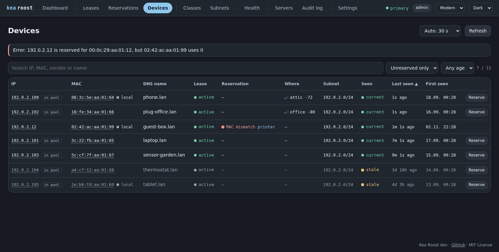
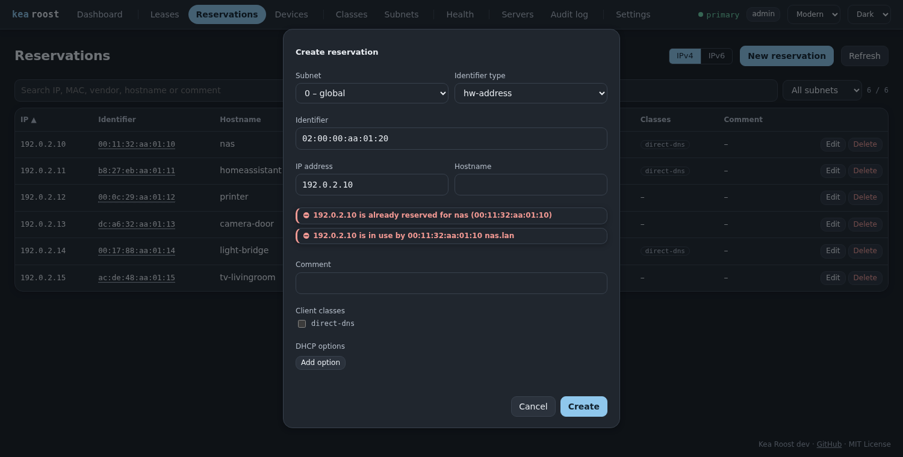

# Devices

[Back to the overview](../README.md)

The devices page lists what is on the network without a reservation for its MAC or
address; a filter adds the reserved ones. Devices are marked current (seen within 15
minutes), recent (last day) or stale, and an address used by another device than the
reserved one is marked as a MAC mismatch. **Reserve** opens the reservation dialog with
address, MAC and name filled in; a conflict shows while typing.

The data comes from two optional integrations, and the page exists only with at least
one of them. Only devices inside a configured subnet are listed. If a source is
unreachable, only its part is missing.

## arpmonitor

[arpmonitor](https://github.com/vgropp/arpmonitor) records MAC and IP addresses from
ARP traffic, so it also finds wired and static devices that Kea knows nothing about.
It resolves names through DNS and knows when a device was first and last seen. Run it
with `--arp-scan-interval=5m` to also find silent devices and to make the last seen
time reflect what is online right now.

`ARPMONITOR_URL` is the base URL, for example `http://host.docker.internal:8253`.
The [Settings](configuration.md#settings) page sets how far back Kea Roost looks; the
`--retention-days` flag of the monitor decides how far back there is data.

## openwrt-ap-dashboard

[openwrt-ap-dashboard](https://github.com/vgropp/openwrt-ap-dashboard) collects the
WiFi clients of several OpenWrt access points. With `APDASHBOARD_URL` set, the devices
and leases pages show the access point and signal of WiFi clients, with the network in
the tooltip. A connected client counts as seen now, and clients the monitor does not
know get their own entry. Kea Roost only reads from the dashboard.
