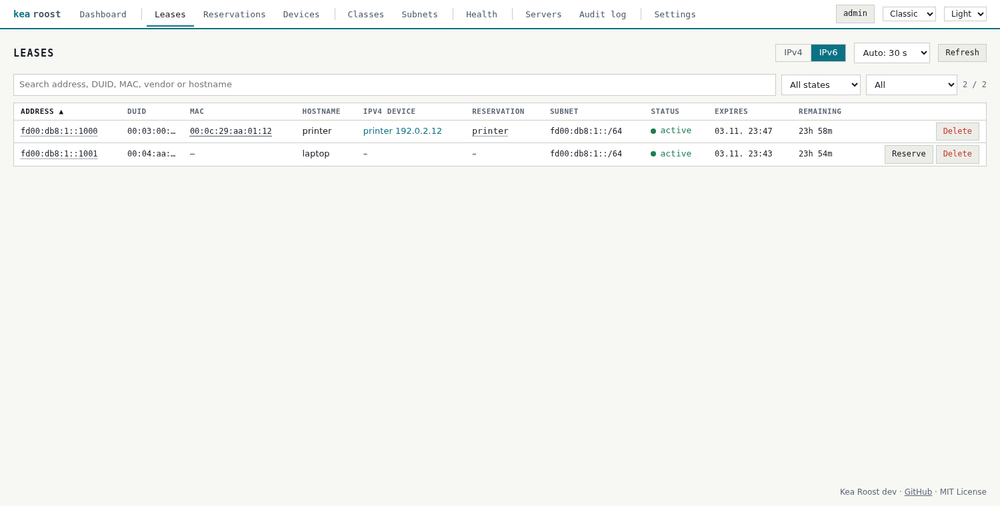
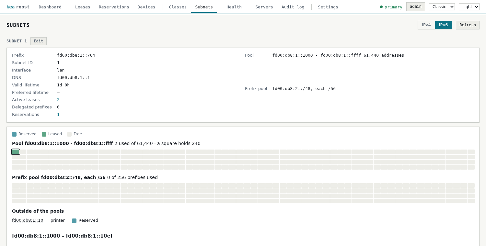

# IPv6

[Back to the overview](../README.md)

Kea Roost can show a `kea-dhcp6` next to `kea-dhcp4`. IPv4 stays the center; IPv6 adds
leases and subnets to look at and reservations to edit.

## Setup

Prepare `kea-dhcp6` as described in [Kea configuration](kea-configuration.md#kea-dhcp6),
then set in `.env`:

    KEA6_URL=http://192.0.2.1:8052

It uses the login of `KEA_URL`. For an HA standby, see
[Several Kea servers](several-servers.md#ipv6).

## In the interface

Leases, Reservations and Subnets get an IPv4|IPv6 switch; the navigation stays the same.

- **Leases:** address or delegated prefix, DUID, MAC, name, state and expiry. Admins
  delete them on every `kea-dhcp6`, like IPv4 leases. A click on an address opens the
  client: its lease, its reservation, why it has this address and which options it
  receives from which level.
- **Reservations:** by DUID or MAC, with addresses, delegated prefixes for a router,
  and a name. Admins create, edit and delete them, or reserve a lease with
  **Reserve**. A new reservation starts with the prefix of its subnet, and a short
  address such as `::20` is completed with it. The dialog shows where the pools are,
  warns when an address lies in one and offers a free address outside of them.
  Changes are backed up, saved and checked like every change.
- **Subnets:** prefix, interface, pools, prefix pools, DNS servers, lifetimes and
  counts. Admins edit pools, prefix pools, DNS servers and lifetimes.

A pool of IPv6 addresses is far too large for a square per address: each square
stands for an equal share of it and shows whether anything in it is reserved or
leased. A prefix pool gets a square per prefix it hands out, up to 1,024. A click on a
square lists what is used in it.

The dashboard shows the latest IPv6 leases and the use of the IPv6 pools, the Servers
and Health pages cover `kea-dhcp6`, the [configuration review](diagnostics.md#ipv6) has
rules for it, [Prometheus](metrics.md) gets its metrics, and the
[hosts file](dns-names.md) gets the IPv6 reservations.

## Linking clients to devices

IPv6 clients name themselves by a DUID, not by their MAC. Kea Roost finds the MAC where
it can, and then shows the IPv4 reservation of that MAC as the device:

- from Kea, if the client sent it,
- from the DUID, for the types LLT and LL, which contain one,
- from an IPv4 lease whose client-id holds the same DUID (RFC 4361), common on Linux,
- from the [ARP monitor](devices.md#arpmonitor), which sees the MAC that uses the
  address.

The tooltip of the MAC says which. The link is a hint: it is what the client claims
about itself. A click on a shortened DUID or client-id shows all of it, selected for
copying.

A lease in state **registered** is an address the client chose itself and reported to
Kea (RFC 9686). Kea did not hand it out, so it cannot be reserved.

## Things to know

- Clients only ask Kea when a router advertisement has the M flag. Kea does not send
  those; a router or `radvd` has to.
- Android does not use DHCPv6 and is missing in Kea, unless it reports its addresses.
