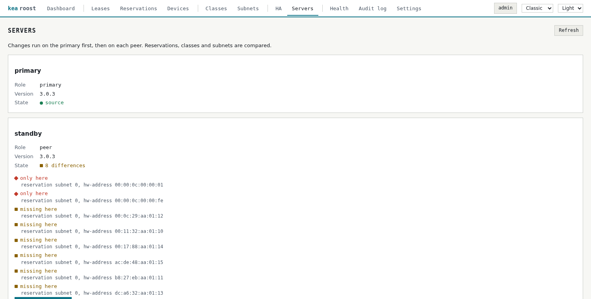

# Several Kea servers and HA

[Back to the overview](../README.md)

Kea HA copies leases, not configuration. With peers, Kea Roost keeps reservations,
client classes and subnets the same on all servers and operates HA.

    KEA_URL=http://192.0.2.1:8051
    KEA_SERVER_NAME=primary
    KEA_PEERS=standby=http://192.0.2.2:8051

Every peer needs the hooks of the primary, a control socket with the same login, and a
configuration file the Kea user can write, see [Kea configuration](kea-configuration.md).

## Changes

- A change runs on the primary first, then on each peer: backup, change,
  `config-write`, check. Each server keeps its own file, so `this-server-name`,
  `interfaces-config` and the `interface` of a subnet stay as they are and are not
  compared.
- If a server fails, the change stops there and reports `partial`. Nothing is rolled
  back.
- Deleting a lease also deletes it on the peers.
- While the primary is down, pages show the data of the first peer that answers, and
  changes are refused.

Settings outside of reservations, classes and subnets, such as global options, are
neither compared nor copied.

## Servers page

One card per server with its state, version, HA state and what differs from the primary.

- **Copy from primary** makes a peer match the primary and deletes what only the peer
  holds. Subnets that are missing or extra stay manual.
- **HA actions:** start and end maintenance, sync leases, reset and continue, as the HA
  state allows. Maintenance needs both servers in the list. Every action goes to the
  audit log.

The dashboard lists every server; with a single one, the page shows only its state.

## IPv6

A `kea-dhcp6` pair gets its own list, with the names used in `KEA_PEERS`. The primary
`kea-dhcp6` carries the name of `KEA_SERVER_NAME`.

    KEA6_URL=http://192.0.2.1:8052
    KEA6_PEERS=standby=http://192.0.2.2:8052

IPv6 reservations, subnets and lease deletions then reach every `kea-dhcp6` the same
way, and the Servers page shows DHCPv4 and DHCPv6 side by side. Kea runs HA separately
for each: two HA blocks, two ports, and two states that can differ.
