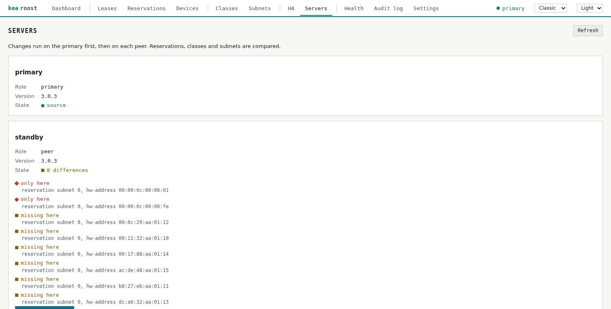
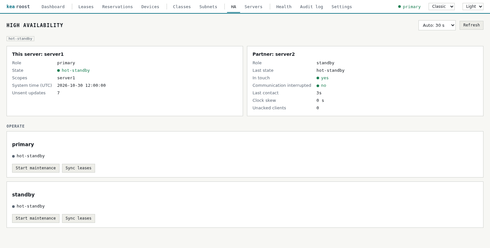

# Several Kea servers and HA

[Back to the overview](../README.md)

Kea HA copies leases, not configuration. With `KEA_PEERS` set, Kea Roost keeps the
reservations, client classes and subnets of all servers the same:

    KEA_URL=http://192.0.2.1:8051
    KEA_SERVER_NAME=primary
    KEA_PEERS=standby=http://192.0.2.2:8051

- All pages read from the primary. While it is down, they show the data of the first
  peer that answers and the dashboard says so. Changes are refused until the primary
  is back, because they always start there.
- A change runs on the primary first, then on each peer: backup, change,
  `config-write`, verification. Each server writes its own file, so
  `this-server-name` and `interfaces-config` stay as they are.
- If a server fails, the change stops there and reports `partial`. Nothing is
  rolled back. The primary failing leaves the peers untouched.
- The Servers page lists what differs from the primary. **Copy from primary** makes
  a peer match it, which also deletes what only the peer holds. Subnets that are
  missing, extra or hold their own reservations stay manual.
- Deleting a lease also deletes it on the peers.
- The HA page operates the pair: start and end maintenance, sync leases, reset and
  continue. It offers what the state of the server allows, and every action is
  written to the audit log. Maintenance needs both servers in `KEA_PEERS`.

Every peer needs the hooks of the primary, a control socket with the same login,
and a configuration file the Kea user can write. Settings outside of these three
areas, such as global options, are neither compared nor copied.

## In the interface

The dashboard lists every server, and the Servers page shows what differs from the primary.

The HA page shows the state of the pair and offers what that state allows.

